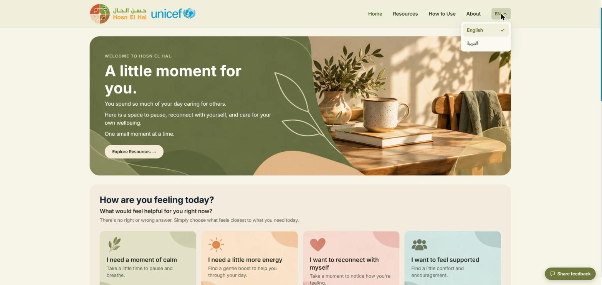
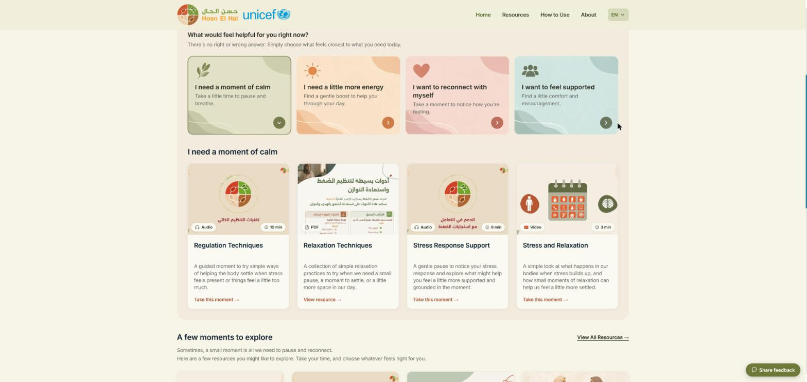
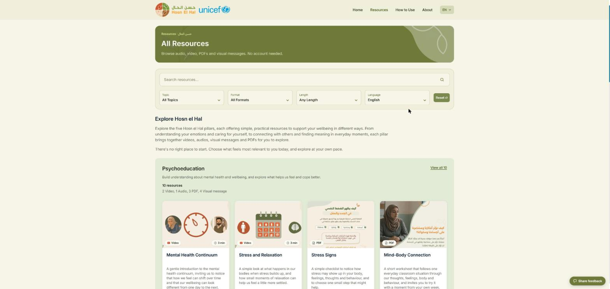
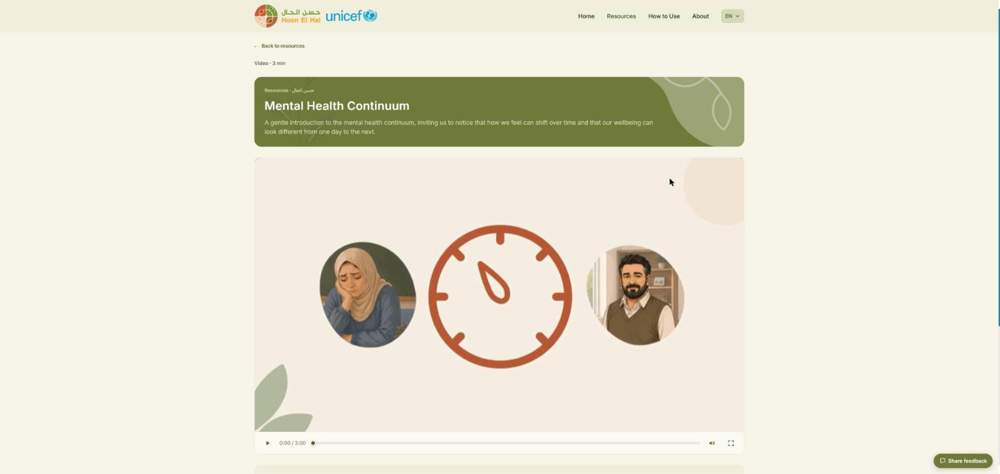
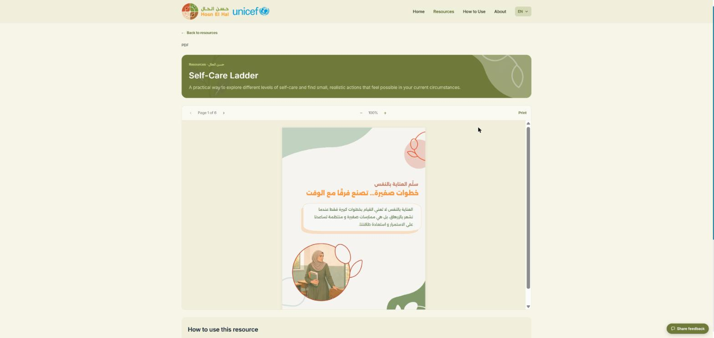

# Hosn El Hal

### Table of Figures

Figure 1: Home page and language selection

Figure 2: How are you feeling today? – suggested resources

Figure 3: Resources page with search and filters

Figure 4: Video resource

Figure 5: PDF resource

Figure 6: Share feedback pop-up

### Introduction

Hosn El Hal (حسن الحال) is a programme hosted on the uSupport platform. It offers short, practical resources that support the mental health and psychosocial wellbeing of teachers and education staff, so that they can in turn provide nurturing care to children and young people affected by crises. The resources were developed by UNICEF together with the Norwegian Refugee Council, Save the Children, UNRWA and War Child Alliance, with input from UNRWA staff and teachers in Jordan, Lebanon, Palestine and Syria.

### What is the Hosn El Hal website?

The Hosn El Hal website (https://teacher.wellbeing.usupport.online) is a public resource hub. It does not include user accounts, providers, consultations or the other features of the Client Interface. All resources – videos, audio, PDFs and visual messages – are available without an account, in English and Arabic.

There is no required sequence and no training is needed. The resources can be used:

* For oneself – whenever a teacher needs a wellbeing moment.
* With colleagues – shared or experienced together.
* Within existing spaces – integrated into a meeting, training, orientation or other professional learning or support space.

The resources are not a replacement for professional mental health and psychosocial support. The content of the website is managed in the uSupport CMS.

### Processes

### 1. Access Hosn El Hal

Step 1: Navigate to the Hosn El Hal website (https://teacher.wellbeing.usupport.online).

Step 2: To change the language, open the language menu in the header (see Figure 1) and select “English” or “العربية” (Arabic).

The header contains the main navigation – “Home”, “Resources”, “How to Use” and “About”. The footer contains links to the privacy policy, terms of use and cookie policy, the “Cookie Settings” option and the “When you need more support” page (see section 6).

<figure><figcaption>
Figure 1: Home page and language selection
</figcaption></figure>

### 2. Find resources by how you feel

Step 1: On the navigation menu select “Home”.

Step 2: In the “How are you feeling today?” section, select the option that feels closest to what you need.

Step 3: Choose one of the suggested resources.

Four options are available: “I need a moment of calm”, “I need a little more energy”, “I want to reconnect with myself” and “I want to feel supported”. Selecting an option displays a set of suggested resources for it below the options (see Figure 2).

The home page also presents a few featured resources (“A few moments to explore”), with a link to all resources, and a link to the “How to Use” page for new visitors.

<figure><figcaption>
Figure 2: How are you feeling today? – suggested resources
</figcaption></figure>

### 3. Browse and filter resources

Step 1: On the navigation menu select “Resources”.

Step 2: Search for a resource or narrow down the list using the filters.

The following filters are available, and “Reset” clears all of them (see Figure 3):

* Topic – one of the five Hosn El Hal pillars.
* Format – video, audio, PDF or visual message.
* Length – under 5 minutes, 5–15 minutes or over 15 minutes.
* Language – English, Arabic or all languages; it starts on the language you are browsing in.

Below the filters, resources are grouped by the five pillars: Psychoeducation, Self-Awareness, Realistic Self-Care, Peer Support and Reconnecting with Purpose. Each pillar shows its description, the number of resources by format, a few resources, and a “View all” link to the complete list for that pillar.

<figure><figcaption>
Figure 3: Resources page with search and filters
</figcaption></figure>

### 4. Use a resource

Step 1: Select a resource (“Take this moment” for videos and audio, “View resource” for PDFs and visual messages).

Step 2: Watch, listen to or read the resource on its page.

Each resource page shows the format and length, a short description and the resource itself (see Figures 4 and 5):

* Videos and audio open in a player with play, sound and full-screen controls.
* PDFs open in a reader with page navigation and zoom. The “Print” option opens the original PDF in a new tab, where it can be printed or saved for offline use.
* Visual messages are displayed as images.

Below the resource, “How to use this resource” gives practical suggestions for using it on one’s own or with a group. “Back to resources” returns to the resource list.

<figure><figcaption>
Figure 4: Video resource
</figcaption></figure>

<figure><figcaption>
Figure 5: PDF resource
</figcaption></figure>

### 5. Read how to use Hosn El Hal

Step 1: On the navigation menu select “How to Use”.

This page explains the different ways of using the resources (for oneself, with colleagues and within existing spaces), the three steps of using a resource (find, open and use, and keep for later), and how resources can be used in trainings and staff meetings.

### 6. Find more support

Step 1: In the footer, select “When you need more support”.

This page explains that the Hosn El Hal resources do not replace professional mental health and psychosocial support. It encourages teachers to reach out to someone they trust, a school counsellor, a supervisor or a support service available through their organisation. It also gives guidance on supporting a student or colleague, and on following the organisation’s referral, protection and emergency procedures.

### 7. Share feedback

Step 1: Click the “Share feedback” button in the bottom-right corner of any page.

Step 2: Answer the question “Have you used the Hosn el Hal resources? Would you recommend them to a friend?” by selecting the thumbs up or thumbs down button (see Figure 6).

<figure><figcaption>
Figure 6: Share feedback pop-up
</figcaption></figure>

### 8. Learn about the programme

Step 1: On the navigation menu select “About”.

This page explains why teachers’ wellbeing matters, how Hosn El Hal came together through a regional partnership, what makes it different, and the thinking behind its design. It also lists the partners and the contacts for queries or comments.
