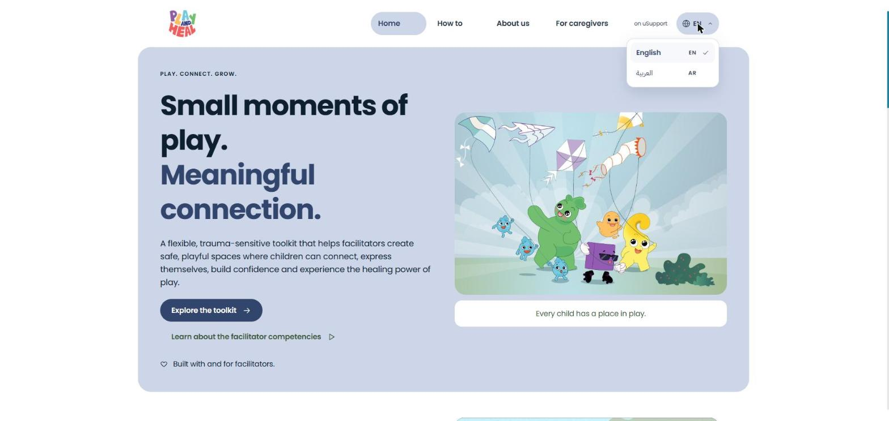
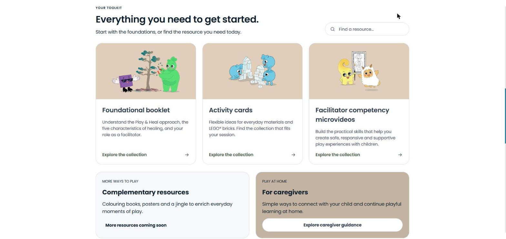
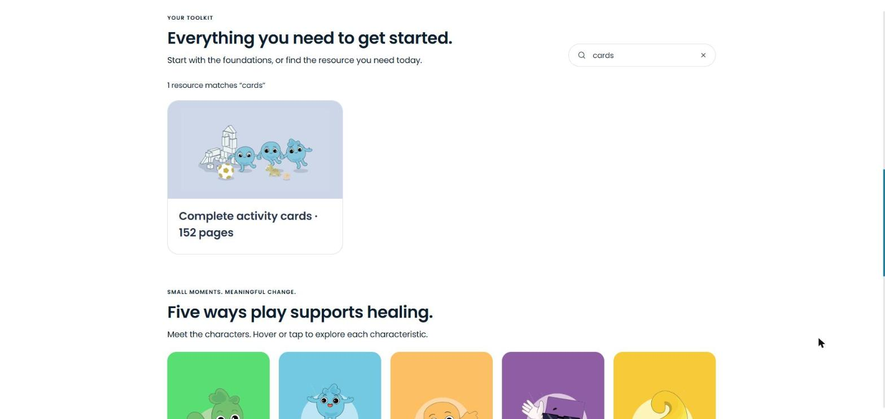
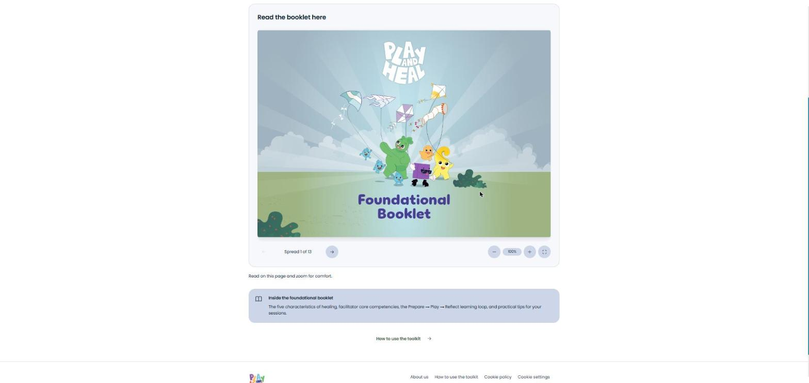
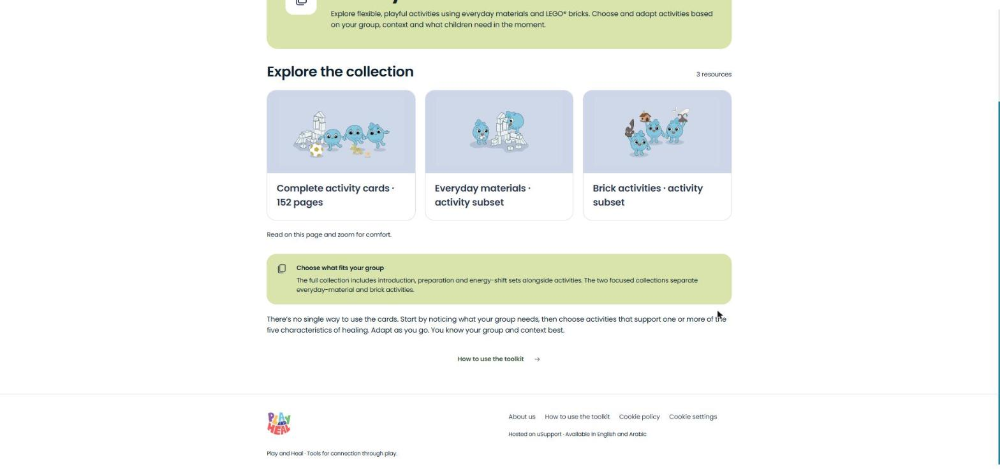
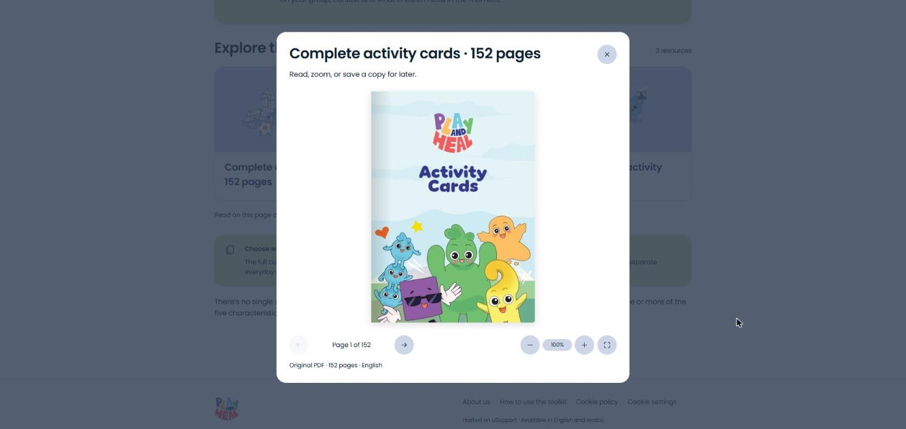
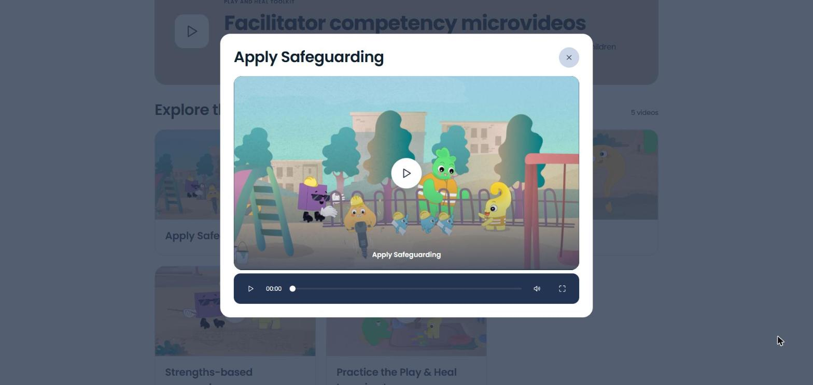
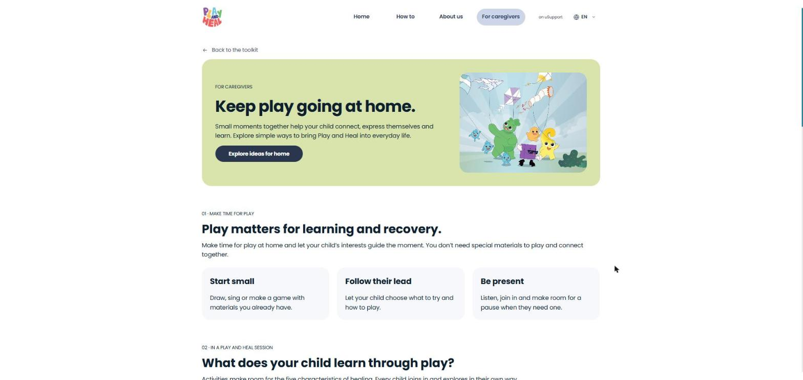

# Play and Heal

### Table of Contents

[Table of Figures](play-and-heal.md#table-of-figures)

[Introduction](play-and-heal.md#introduction)

[What is the Play and Heal website?](play-and-heal.md#what-is-the-play-and-heal-website)

[Processes](play-and-heal.md#processes)

[1. Access Play and Heal](play-and-heal.md#id-1.-access-play-and-heal)

[2. Explore the home page](play-and-heal.md#id-2.-explore-the-home-page)

[3. Search the toolkit](play-and-heal.md#id-3.-search-the-toolkit)

[4. Read the foundational booklet](play-and-heal.md#id-4.-read-the-foundational-booklet)

[5. Open the activity cards](play-and-heal.md#id-5.-open-the-activity-cards)

[6. Watch the facilitator competency microvideos](play-and-heal.md#id-6.-watch-the-facilitator-competency-microvideos)

[7. Read the toolkit guidance](play-and-heal.md#id-7.-read-the-toolkit-guidance)

[8. Access the caregiver guidance](play-and-heal.md#id-8.-access-the-caregiver-guidance)

[9. Learn about the programme](play-and-heal.md#id-9.-learn-about-the-programme)

### Table of Figures

Figure 1: Navigation menu and language selection

Figure 2: Home page – toolkit collections

Figure 3: Toolkit search results

Figure 4: Foundational booklet reader

Figure 5: Activity cards collection

Figure 6: Document reader

Figure 7: Facilitator competency video player

Figure 8: Caregiver guidance

### Introduction

Play and Heal is a programme hosted on the uSupport platform. It provides a flexible, trauma-sensitive psychosocial support toolkit that helps facilitators create safe, playful spaces where children affected by crises can connect, express themselves and build confidence. The toolkit was co-created by the LEGO Foundation, UNICEF and Care for Education, together with facilitators and children in Lebanon.

### What is the Play and Heal website?

The Play and Heal website (https://playandheal.usupport.online) is a public resource site. Unlike the uSupport country platforms, it does not include user accounts, providers, consultations or the other features of the Client Interface. All resources are available without registration, in English and Arabic.

The website is intended for:

* Facilitators working with children in humanitarian emergencies, safe community spaces, schools and other group settings, under the care of trained adults. The toolkit complements existing mental health and psychosocial support services.
* Caregivers who want to continue playful activities with their children at home.

The content of the website is managed in the uSupport CMS.

### Processes

### 1. Access Play and Heal

Step 1: Navigate to the Play and Heal website (https://playandheal.usupport.online).

Step 2: To change the language, open the language menu in the header and select “English” or “العربية” (Arabic) (see Figure 1).

The header contains the main navigation – “Home”, “How to”, “About us” and “For caregivers” – together with an “on uSupport” link to the uSupport platform. When Arabic is selected, the website address changes to /ar and the layout switches to right-to-left. Videos are played in the selected language.

On the first visit, a banner asks the visitor to accept or reject non-essential cookies (analytics cookies, including session recording). The choice can be changed at any time through “Cookie settings” in the footer.

<figure><figcaption>
Figure 1: Navigation menu and language selection
</figcaption></figure>

### 2. Explore the home page

Step 1: On the navigation menu select “Home”.

The home page presents the following sections (see Figure 2):

* New to Play & Heal? Start here – a short introduction video.
* Your toolkit – the three toolkit collections (Foundational booklet, Activity cards and Facilitator competency microvideos) and the toolkit search.
* More ways to play – complementary resources, such as colouring books, posters and a jingle (coming soon).
* For caregivers – a shortcut to the caregiver guidance (see section 8).
* Five ways play supports healing – the five characteristics of healing (Safety, Connection & belonging, Expression, Mastery and Sense of self), each presented by a character. Hover over or tap a character to read its description.
* New to Play and Heal? – three steps for getting started: get to know the toolkit, build facilitation skills and bring play into sessions.

<figure><figcaption>
Figure 2: Home page – toolkit collections
</figcaption></figure>

### 3. Search the toolkit

Step 1: On the home page, go to the “Everything you need to get started” section.

Step 2: Type a word in the “Find a resource…” field (see Figure 3).

Step 3: Select a resource from the results to open it in the document reader (see section 5).

The results are updated as the visitor types and show the number of matching resources (for example, “1 resource matches ‘cards’”). The search matches the names of the toolkit resources. If no resource matches, the visitor is asked to try another word. The search can be cleared with the “×” button.

<figure><figcaption>
Figure 3: Toolkit search results
</figcaption></figure>

### 4. Read the foundational booklet

Step 1: On the home page, in the “Your toolkit” section, select “Foundational booklet”.

Step 2: Read the booklet directly on the page, moving between its spreads and zooming as needed (see Figure 4).

The foundational booklet introduces the Play and Heal approach: the five characteristics of healing, the facilitator core competencies, the Prepare → Play → Reflect learning loop and practical tips for sessions.

<figure><figcaption>
Figure 4: Foundational booklet reader
</figcaption></figure>

### 5. Open the activity cards

Step 1: On the home page, in the “Your toolkit” section, select “Activity cards”.

Step 2: Choose one of the documents and click “Open document”.

The activity cards offer flexible activities using everyday materials and LEGO® bricks. Three documents are available (see Figure 5):

* Complete activity cards – the full collection, including the introduction, preparation and energy-shift sets alongside the activities.
* Everyday materials – a subset with the activities that use everyday materials.
* Brick activities – a subset with the activities that use LEGO® bricks.

<figure><figcaption>
Figure 5: Activity cards collection
</figcaption></figure>

Documents open in the document reader pop-up (see Figure 6). The reader allows the visitor to move between pages with the previous and next buttons (“Page 1 of 152”), zoom in and out, and switch to full screen. The information line below the document shows the file type, the number of pages and the language. The reader can be closed with the “×” button or the Esc key.

<figure><figcaption>
Figure 6: Document reader
</figcaption></figure>

### 6. Watch the facilitator competency microvideos

Step 1: On the home page, in the “Your toolkit” section, select “Facilitator competency microvideos”.

Step 2: Choose a video and click “Watch video”.

Five videos present the facilitator competencies: Apply Safeguarding, Manage Reactions, Be Curious, Strengths-based approach and Practice the Play & Heal Learning Loop. Each video opens in a pop-up player with play, progress, sound and full-screen controls (see Figure 7). The videos are played in the language selected for the website.

<figure><figcaption>
Figure 7: Facilitator competency video player
</figcaption></figure>

### 7. Read the toolkit guidance

Step 1: On the navigation menu select “How to”.

This page explains how to use the toolkit: where to start, how to use it within different settings, and the importance of following the organisation’s child safeguarding and reporting procedures. It also includes guidance for facilitators (facilitator selection, age group adaptations, PlayBoxes partnership and facilitator support) and answers to frequently asked questions.

### 8. Access the caregiver guidance

Step 1: On the navigation menu select “For caregivers”.

This page helps caregivers continue play at home (see Figure 8). It explains why play matters, what children experience in a Play and Heal session, three questions to start a conversation after a session, and how to use the competency videos and activity cards at home. It also suggests sharing games from the caregiver’s own childhood.

<figure><figcaption>
Figure 8: Caregiver guidance
</figcaption></figure>

### 9. Learn about the programme

Step 1: On the navigation menu select “About us”.

This page describes how Play and Heal was co-created between 2023 and 2026, the partners and contributors involved, and the five characteristics of healing at the heart of the toolkit.
